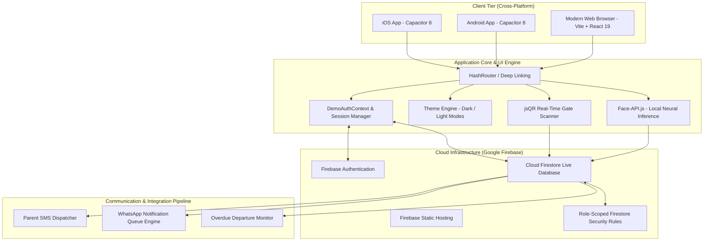

# 🏢 RGM Hostel Portal — Smart Campus Living & Automated Operations

<p align="center">
  
</p>

<p align="center">
  <strong>Next-Generation Enterprise Hostel Management System with Browser-Native Face Recognition (FRS), Smart QR Gate Passes, Automated Parent Alerts, and Multi-Role Administration.</strong>
</p>

<p align="center">
  <a href="https://github.com/Rafi12-hub/Hostel-Management-System/blob/main/LICENSE"></a>
  
  
  
  
  
  
</p>

---

## 📑 Table of Contents

- [Overview](#-overview)
- [System Architecture](#-system-architecture)
- [Key Features](#-key-features)
  - [1. Public Campus & Marketing Portal](#1-public-campus--marketing-portal)
  - [2. Student & Parent Self-Service](#2-student--parent-self-service)
  - [3. AI Biometric Face Recognition (FRS)](#3-ai-biometric-face-recognition-frs)
  - [4. Smart Gate Security & Entry/Exit Tracking](#4-smart-gate-security--entryexit-tracking)
  - [5. Intelligent Mess & Dining Management](#5-intelligent-mess--dining-management)
  - [6. Warden & Administrative Governance](#6-warden--administrative-governance)
- [Role-Based Access Control (RBAC)](#-role-based-access-control-rbac)
- [Tech Stack](#-tech-stack)
- [Database Schema & Firestore Security](#-database-schema--firestore-security)
- [Getting Started](#-getting-started)
  - [Prerequisites](#prerequisites)
  - [Local Installation](#local-installation)
  - [Environment Variables](#environment-variables)
  - [Firebase Configuration & Security Rules](#firebase-configuration--security-rules)
- [Mobile App (Android & iOS)](#-mobile-app-android--ios)
  - [Pre-built APK](#pre-built-apk)
  - [Compiling with Capacitor](#compiling-with-capacitor)
- [Pre-Configured Demo Accounts](#-pre-configured-demo-accounts)
- [NPM Scripts Reference](#-npm-scripts-reference)
- [Deployment Strategy](#-deployment-strategy)
- [Roadmap & Enhancements](#-roadmap--enhancements)
- [Contributing](#-contributing)
- [License](#-license)
- [Author & Acknowledgments](#-author--acknowledgments)

---

## 🌟 Overview

The **RGM Hostel Portal** is a production-grade, end-to-end hostel operating system designed specifically for collegiate residential campuses (developed for **RGMCET — RGM College of Engineering & Technology**). 

Traditional residential campus management relies on fragmented paper registers, sluggish manual roll calls, disconnected gate guards, and zero visibility for anxious parents. **RGM Hostel Portal** unifies campus life into an integrated, real-time ecosystem:
- **Zero-Hardware Biometric Roll Call**: Instant face recognition using TensorFlow-based models running client-side inside the browser/mobile webview without expensive proprietary biometric scanners.
- **Dynamic QR Gate Security**: Cryptographically traceable student entry/exit tracking that alerts security if a student is overdue.
- **Automated Parent Communication**: Real-time SMS and WhatsApp dispatches whenever students leave or return to campus.
- **Mess Wastage Prevention**: Predictive meal pre-booking analytics that enable catering staff to prepare exact portions and minimize food loss.
- **Native Cross-Platform**: Runs seamlessly as a high-performance web app and as native Android and iOS applications via Capacitor 8.

---

## 🏗 System Architecture



---

## 🚀 Key Features

### 1. Public Campus & Marketing Portal
* **Live Campus Showcase**: Detailed presentation of boy's and girl's hostel blocks, amenities, security protocols, and accommodation options.
* **Daily Dining Menu**: Publicly accessible mess menus updated daily for breakfast, lunch, snacks, and dinner.
* **Campus Broadcasts**: Live noticeboard for hostel announcements, disciplinary policies, warden contact directories, and emergency protocols.
* **Interactive FAQ & Grievance Contact**: In-app inquiries and emergency contacts for medical, security, and administrative desks.

### 2. Student & Parent Self-Service
* **Dynamic Student Dashboard**: Live view of assigned hostel block, room number, roommate information, attendance rates, and mess schedules.
* **One-Click Gate Pass Generation**: Students apply for local out-passes or home leave, automatically receiving a cryptographically verifiable QR pass upon approval.
* **Parent Dedicated Portal**: Parents monitor their child’s live location status (In Hostel / Out on Pass), leave records, entry/exit timestamp history, and warden notes.
* **Room Maintenance Ticketing**: File complaints (electrical, plumbing, carpentry, Wi-Fi) with real-time status tracking and technician assignment.

### 3. AI Biometric Face Recognition (FRS)
* **Client-Side Neural Processing**: Uses `face-api.js` (SSD MobileNet / Tiny Face Detector, 68-point facial landmark detector, and 128-dimensional embedding model) loaded directly from `/public/models`.
* **Zero Cloud Latency**: Biometric inference occurs directly on the client machine or mobile camera; no raw biometric video stream leaves the device.
* **Liveness Detection & Anti-Spoofing**: Verifies eye blinking and head movement to block photograph-based impersonation attempts.
* **Night Roll Call (NRC)**: Instant warden-supervised check-ins across hostel blocks, recording check-in timestamps and generating automated absentee lists.

### 4. Smart Gate Security & Entry/Exit Tracking
* **High-Speed QR Scanner**: Security personnel scan passes via mobile cameras or barcode terminals at the campus perimeter gates.
* **Tamper-Proof Gate Logs**: Every entry and exit writes to an append-only `GateLog` collection in Firestore with permanent timestamps.
* **Overdue Detection Service**: Automated monitoring highlights students who have not checked back in within their authorized gate pass time window.
* **Instant Parent Alerting**: Dispatches SMS/WhatsApp alerts to registered guardian numbers the moment a student passes through the gate.

### 5. Intelligent Mess & Dining Management
* **Meal Pre-Booking Panel**: Students confirm or cancel meals ahead of time, providing the mess manager with accurate headcounts.
* **Food Wastage Analytics**: Visual charts (via Recharts) displaying planned vs. actual dining attendance to help kitchen supervisors optimize portion preparation.
* **QR-Verified Dining Counters**: Prevent unauthorized dining access with quick meal verification checkpoints.
* **Direct Feedback & Rating Hub**: Students rate meal quality, taste, and hygiene directly from their portal.

### 6. Warden & Administrative Governance
* **Room & Bed Matrix**: Visual grid of all hostel blocks, floors, and rooms showing live occupancy, vacant beds, and maintenance holds.
* **Comprehensive Student Directory**: Search, filter, and inspect student contact info, emergency contacts, disciplinary records, and leave history.
* **Audit Logs & Exportable Reports**: Export gate activity logs, leave reports, mess attendance records, and roll call archives to CSV/Excel.
* **Role Management & Account Provisioning**: Centralized console for creating, updating, and deactivating user roles across the institution.

---

## 👥 Role-Based Access Control (RBAC)

The portal implements enterprise role segregation enforced at both the client routing layer (`DemoProtectedRoute`) and the database layer (`firestore.rules`):

| Role | Portal Dashboard | Gate Pass / Leave | Gate Scanner | Face Roll Call | Mess Mgmt | Housekeeping | Room Allocations | User Admin |
|:-----|:----------------:|:-----------------:|:------------:|:--------------:|:---------:|:------------:|:----------------:|:----------:|
| **Admin** | 🟢 Full Access | 🟢 View / Override | 🟢 Scan / Logs | 🟢 Full Access | 🟢 Full View | 🟢 Full View | 🟢 Full Control | 🟢 Full Control |
| **Chief Warden** | 🟢 Executive | 🟢 Final Approval | 🟢 Audit Logs | 🟢 All Hostels | 🟢 Analytics | 🟢 Oversight | 🟢 Manage | 🟢 Manage |
| **Warden** | 🟢 Hostel-Scoped | 🟢 Review & Approve | 🟢 View Logs | 🟢 Execute NRC | 🟢 Feedback Hub | 🟢 Schedules | 🟢 Edit Status | 🟢 Staff/Students |
| **Security Officer** | 🟢 Gate Dashboard | 🟡 View Approved | 🟢 Live Scanner | 🔴 Denied | 🔴 Denied | 🔴 Denied | 🔴 Denied | 🔴 Denied |
| **Mess Manager** | 🟢 Kitchen KPIs | 🔴 Denied | 🔴 Denied | 🔴 Denied | 🟢 Menu & Headcounts | 🔴 Denied | 🔴 Denied | 🔴 Denied |
| **Housekeeping** | 🟢 Cleaning Tasks | 🔴 Denied | 🔴 Denied | 🔴 Denied | 🔴 Denied | 🟢 Log Cleans | 🔴 Denied | 🔴 Denied |
| **Student** | 🟢 Personal | 🟢 Apply & Track | 🟡 Show QR Pass | 🟢 Self Check-in | 🟢 Pre-Book Meals | 🟡 File Ticket | 🟡 View Own Room | 🔴 Denied |
| **Parent** | 🟢 Ward Activity | 🟡 View Status | 🔴 Denied | 🔴 Denied | 🔴 Denied | 🔴 Denied | 🟡 View Ward Room | 🔴 Denied |
| **Management / Principal** | 🟢 KPI Reports | 🟢 View Logs | 🟢 Audit Logs | 🟢 Analytics | 🟢 Analytics | 🟢 Analytics | 🟢 View Matrix | 🟡 View Only |

---

## 💻 Tech Stack

### Frontend & UI
- **React 19 (`v19.2.8`)**: State-of-the-art concurrent React with optimized lazy component trees.
- **TypeScript (`~6.0.2`)**: Strict end-to-end type safety for Firestore entities and component props.
- **Vite 8 (`v8.2.2`)**: Instant HMR and lightning-fast ES module bundling.
- **Tailwind CSS 4 (`v4.3.3`)**: Next-generation CSS engine featuring ultra-fast compile times and modern color palettes.
- **Framer Motion (`v13.1.1`)**: Smooth micro-interactions, drawer slides, and status card transitions.
- **Lucide React (`v1.34.0`)**: Comprehensive, modern icon set.
- **Recharts (`v3.10.1`)**: Responsive SVG charts for mess headcount forecasting and attendance trends.

### Mobile & Native Runtime
- **Capacitor 8 (`@capacitor/core`, `@capacitor/android`, `@capacitor/ios`)**: Native webview container providing hardware camera access, persistent local storage, and Android/iOS compilation.
- **HashRouter (`react-router-dom v7`)**: Resilient routing optimized for mobile APK file protocols and deep linking.

### Computer Vision & AI
- **`face-api.js` (`v0.22.2`)**: Client-side TensorFlow.js neural network models:
  - `tiny_face_detector`: Fast, low-latency bounding box face detection.
  - `face_landmark_68`: 68-point geometric landmark localization for liveness checks.
  - `face_recognition`: High-accuracy 128-dimensional facial feature descriptor extraction.
- **`jsqr` (`v1.4.0`)**: High-speed QR barcode decoding engine for gate pass and mess counter scanners.

### Cloud Backend
- **Firebase Authentication (`v12.18.0`)**: Secure email/password authentication with support for custom role claims.
- **Cloud Firestore**: Real-time NoSQL document database with live subscription listeners (`onSnapshot`).
- **Firebase Hosting**: Worldwide CDN hosting configured with multi-site targets (`prod` and `staging`).

---

## 🗄 Database Schema & Firestore Security

The database follows a modular collection structure in Cloud Firestore, safeguarded by role-scoped rules (`firestore.rules`):

```
Cloud Firestore
├── Hostel/               # Public read; Admin write. Details on campus hostel blocks.
├── Menu/                 # Public read; Mess Manager / Admin write. Weekly dietary menus.
├── Announcement/         # Public read; Staff write. Campus-wide notices.
├── Settings/             # Public read; Staff write. Operational configs (meal timings, curfew).
├── User/                 # Signed-in read; Admin/Warden write. Role profiles & metadata.
├── Student/              # Signed-in read; Warden/Admin write. Official academic & hostel data.
├── Room/                 # Signed-in read/write. Block/floor/room capacity & occupancies.
├── GatePass/             # Student create; Staff approve/manage. Outing & home leave passes.
├── GateLog/              # Append-only (update/delete blocked). Immutable security gate logs.
├── Leave/                # Extended leave records and warden approval state.
├── MealBooking/          # Meal reservations and headcount reservations.
├── MessAttendance/       # Real-time dining hall scans and meal pickups.
├── NightRollCallSessions/# Night roll call sessions initiated by wardens.
├── NightRollCallRecords/ # FRS check-in records containing facial verification results.
├── Cleaning/             # Housekeeping sanitation schedules and room inspections.
├── Maintenance/          # Facility maintenance tickets and technician logs.
├── Inventory/            # Hostel asset inventory (furniture, appliances, sports equipment).
├── NotificationJob/      # Asynchronous SMS & WhatsApp parent notification queue.
└── ParentNotification/   # Historical audit of messages dispatched to guardians.
```

> **Security Guarantee**: The `GateLog` collection is enforced as **strictly append-only** in `firestore.rules` (`allow update, delete: if false;`), ensuring that guard logs cannot be falsified or deleted after creation.

---

## 🛠 Getting Started

### Prerequisites
- **Node.js**: `v20.0.0` or higher (LTS recommended)
- **Package Manager**: `npm` (`v10+`)
- **Firebase Project**: An active Firebase project with **Authentication**, **Cloud Firestore**, and **Firebase Hosting** enabled.
- **(Optional) For Android Builds**: Android Studio, JDK 17+, Android SDK Platforms 34+.

---

### Local Installation

1. **Clone the repository**:
   ```bash
   git clone https://github.com/Rafi12-hub/Hostel-Management-System.git
   cd Hostel-Management-System
   ```

2. **Install project dependencies**:
   ```bash
   npm install
   ```

---

### Environment Variables

Create a `.env.local` file in the root directory by copying the provided example:

```bash
# On Linux / macOS:
cp .env.example .env.local

# On Windows PowerShell:
Copy-Item .env.example .env.local
```

Fill in your Firebase web application configuration parameters:

```ini
VITE_FIREBASE_API_KEY="your-api-key"
VITE_FIREBASE_AUTH_DOMAIN="your-project-id.firebaseapp.com"
VITE_FIREBASE_PROJECT_ID="your-project-id"
VITE_FIREBASE_STORAGE_BUCKET="your-project-id.appspot.com"
VITE_FIREBASE_MESSAGING_SENDER_ID="your-sender-id"
VITE_FIREBASE_APP_ID="your-app-id"
VITE_FIREBASE_MEASUREMENT_ID="your-measurement-id"
```

---

### Firebase Configuration & Security Rules

1. **Log in to Firebase CLI**:
   ```bash
   npx firebase login
   ```

2. **Select your project**:
   ```bash
   npx firebase use <your-firebase-project-id>
   ```

3. **Deploy Firestore security rules**:
   ```bash
   npm run deploy:rules
   ```

4. **Start the local development server**:
   ```bash
   npm run dev
   ```
   Open your browser at the displayed local URL (typically `http://localhost:5173/`).

---

## 📱 Mobile App (Android & iOS)

The application is natively packaged using **Capacitor 8**. The exact same React codebase runs with hardware acceleration and camera access.

### Pre-built APK
A ready-to-test debug APK is bundled within this repository:
- **Download path**: [`RGM-Hostel-Portal.apk`](./RGM-Hostel-Portal.apk) (Root directory)
- **Web Download Page**: You can also host `public/download.html` on your server to allow students and staff to install the app via their mobile browser.

---

### Compiling with Capacitor

#### Android:
```bash
# 1. Build the production web bundle and sync native assets
npm run mobile:build

# 2. Open Android Studio
npm run android:open

# 3. Or build the debug APK directly from command line
npm run android:apk
```
The compiled APK will be generated at:
`android/app/build/outputs/apk/debug/app-debug.apk`

#### iOS (macOS with Xcode required):
```bash
npm run mobile:build
npx cap sync ios
npx cap open ios
```
In Xcode, choose your target simulator or connected iOS device and click **Run**.

---

## 🔑 Pre-Configured Demo Accounts

For instant testing and evaluation, the portal includes pre-configured demo user profiles representing each functional department:

| Role | Email | Password | Access Highlights |
|:---|:---|:---|:---|
| **System Administrator** | `admin.hostel@rgmcet.edu.in` | `admin123` | System settings, user accounts, audit trails |
| **Chief Warden** | `chief.warden@rgmcet.edu.in` | `chief123` | Executive analytics, student discipline, approvals |
| **Hostel Warden** | `warden.hostel@rgmcet.edu.in` | `warden123` | Night roll call, leave approvals, room status |
| **Mess Manager** | `mess.manager@rgmcet.edu.in` | `mess123` | Daily menu planner, meal headcounts, inventory |
| **Security Guard** | `security.hostel@rgmcet.edu.in` | `security123` | QR gate scanner, entry/exit logs, overdue alerts |
| **Housekeeping Lead** | `housekeeping.hostel@rgmcet.edu.in` | `housekeeping123`| Room sanitation checklists, maintenance requests |
| **Student (Demo)** | `student.demo@rgmcet.edu.in` | `student123` | QR gate pass, room status, FRS check-in |
| **Parent / Guardian** | `parent.demo@rgmcet.edu.in` | `parent123` | Ward location status, leave history, gate logs |

> **Production Notice**: Disable demo user seeding and provision users through your institution's backend Firebase Admin SDK before going to production.

---

## 📜 NPM Scripts Reference

| Command | Action / Description |
|:---|:---|
| `npm run dev` | Launches the local Vite development server with Hot Module Replacement (HMR). |
| `npm run build` | Runs TypeScript compilation (`tsc -b`) and bundles production assets to `/dist`. |
| `npm run preview` | Spins up a local static server to preview the production build. |
| `npm run lint` | Runs `oxlint` for high-speed JavaScript and TypeScript linting. |
| `npm run deploy:rules` | Pushes `firestore.rules` directly to your active Firebase project. |
| `npm run deploy:hosting`| Builds web assets and deploys to the default Firebase Hosting domain. |
| `npm run deploy:staging`| Deploys build assets to the staging Firebase Hosting target. |
| `npm run deploy:prod` | Compiles and deploys to the production Firebase Hosting target. |
| `npm run mobile:build` | Compiles web app and copies bundle assets to Android & iOS Capacitor directories. |
| `npm run mobile:sync` | Synchronizes Capacitor plugins and configuration across native projects. |
| `npm run mobile:icons` | Generates all platform-specific launcher icons and splash screens. |
| `npm run android:open` | Builds web assets and opens the native project in Android Studio. |
| `npm run android:apk` | Compiles a standalone debug APK via Gradle wrapper. |

---

## 🚀 Deployment Strategy

This repository supports multi-environment deployment via Firebase Hosting:

```bash
# 1. Deploy Firestore Security Rules
npm run deploy:rules

# 2. Deploy to Production Target
npm run deploy:prod

# 3. Deploy to Staging Target
npm run deploy:staging
```

Configured targets in `firebase.json`:
- **Production Site**: `rgm-hostel-portal`
- **Staging Site**: `rgmcet-hostel-portal-staging`

---

## 🗺 Roadmap & Enhancements

- [x] Full-featured public institutional website
- [x] Client-side face recognition roll call (FRS)
- [x] Mobile QR gate pass check-in & check-out scanner
- [x] Predictive mess meal headcount booking system
- [x] Multi-target Firebase Hosting deployment setup
- [x] Capacitor 8 Android and iOS native mobile application packaging
- [ ] Push Notifications via Firebase Cloud Messaging (FCM)
- [ ] Direct WhatsApp Business Cloud API webhook integration
- [ ] Automated biometric attendance sync with college ERP system
- [ ] Student fee payment gateway integration (UPI / NetBanking)

---

## 🤝 Contributing

Contributions are welcomed! Follow these steps:

1. **Fork** the repository: `https://github.com/Rafi12-hub/Hostel-Management-System/fork`
2. **Create** your feature branch:
   ```bash
   git checkout -b feature/AmazingFeature
   ```
3. **Commit** your modifications:
   ```bash
   git commit -m "feat: Add AmazingFeature"
   ```
4. **Push** to your branch:
   ```bash
   git push origin feature/AmazingFeature
   ```
5. **Open** a Pull Request against `main`.

---

## 📄 License

Distributed under the **MIT License**. See [`LICENSE`](./LICENSE) for full details.

---

## 👨‍💻 Author & Acknowledgments

- **Developed by**: [Mahammad Rafi](https://github.com/Rafi12-hub)
- **Institution**: RGM College of Engineering & Technology (RGMCET)
- **Special Thanks**: Open-source contributors of [React](https://react.dev), [Vite](https://vitejs.dev), [Tailwind CSS](https://tailwindcss.com), [Capacitor](https://capacitorjs.com), and [face-api.js](https://github.com/justadudewhohacks/face-api.js).
